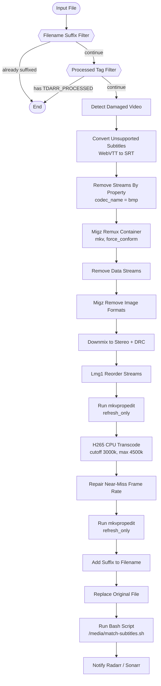

# Tdarr Plugins

Custom [Tdarr](https://home.tdarr.io/) plugins for automated media processing.

## Plugin Flow

The plugins run as Tdarr **Flows**, with each classic plugin wrapped in a "Run Classic Filter/Transcode Plugin" node. Exports of the flows live in this repo:

| File | Library | Notify step |
|------|---------|-------------|
| `flowMovies.json` | Movies | Radarr |
| `flowAnimovies.json` | Animovies | Radarr |
| `flowShows.json` | Shows | Sonarr |
| `flowAnishows.json` | Anishows | Sonarr |
| `flowOtherVideos.json` | Other Videos | _(none)_ |

The committed flows have their Radarr/Sonarr API keys replaced with `YOUR_RADARR_API_KEY` / `YOUR_SONARR_API_KEY`. Keep a copy with the real keys as `flow*.local.json` (gitignored) and import that one into Tdarr. When you change a flow, update both files.

All five share the same layout:



Both outputs of every transcode node ("processed" / "not processed") lead to the next node. A filter's "skip" output is left unconnected, so the flow just ends and skipped files never trigger the script or a rescan.

### Ordering rules

- **Inside a flow, a classic plugin sees the current _working_ file.** After any FFmpeg step, that file is a temp copy in Tdarr's cache directory (`file._id` and `file.meta.Directory` point there), not the file in your library.
- **Detect Damaged Video goes _first_.** It fails the job before any work is done on a file that is missing frames. It must come before H265 CPU Transcode in any case: a re-encode keeps the timing gaps but writes a clean stream, which hides the decoder errors the check relies on.
- **Convert Unsupported Subtitles comes next, before any FFmpeg step.** Every later step copies all streams (`-map 0 -c copy`), and FFmpeg can't copy a track it can't read, so a single WebVTT track stored as `S_TEXT/WEBVTT` fails the whole flow with `Subtitle codec 0 is not supported`.
- **Repair Frame Rate goes _after_ H265 CPU Transcode.** It's the last step that touches video, so the repair can't be undone by a later FFmpeg pass.
- **mkvpropedit runs twice, both times as `refresh_only`.** FFmpeg copies existing statistics unchanged onto the streams it re-encodes, so a re-encoded video can claim its old H.264 bitrate. The first run comes after DRC and Reorder, just before H265 CPU Transcode, so its `max_bitrate` check reads up-to-date `BPS` values. The second run comes after the last step that changes the file (x265 / Repair Frame Rate), so the final file's statistics match its streams.
- **Nothing edits the library file in place.** Radarr and Sonarr hardlink imports to the torrent client's copies, so an in-place edit would also change the seeding torrent. Every step before Replace Original File writes to the Tdarr cache; mkvpropedit `refresh_only` refuses to touch the original; and Add Suffix only renames. That's why the flows don't need Break Hardlink, which used to cost a full copy of every file.
- **One gap from that rule:** if DRC skips an MKV (no audio, or already `TDARR_DRC_PROCESSED`) and no earlier step changed it, the first refresh skips it too. The `max_bitrate` check then only sees statistics the file already had, if any. New imports always have audio and no DRC tag, so they always get fresh statistics.
- **Add Suffix goes _before_ Replace Original File.** It renames the working file, and Replace Original File then puts it in the library folder under the new name, deleting the old one.
- **Bash Script and Notify go _after_ Replace Original File.** They need the final file in its real library folder. Before the replace step, the script would run in the cache directory, the Sonarr plugin wouldn't find the `{imdb-…}` show folder, and Radarr would rescan before the new file existed.

## Plugins

### Pre-processing / Filter

---

#### `Tdarr_Plugin_the1nk_filename_suffix_filter`
**Filename Suffix Filter** — v1.00

Skips the plugin stack if the filename ends with the specified suffix. Useful for preventing reprocessing of files that have already been handled.

| Input | Type | Default | Description |
|-------|------|---------|-------------|
| `suffix` | string | `(Tdarr)` | Suffix to look for in the filename |

---

#### `Tdarr_Plugin_the1nk_processed_tag_filter`
**Processed Tag Filter** — v1.00

Skips the plugin stack if the file has a `TDARR_PROCESSED` FFprobe metadata tag set. Pair this with a plugin that writes the tag to prevent files from being reprocessed on every Tdarr cycle.

No inputs.

---

### Pre-processing / Transcode

---

#### `Tdarr_Plugin_The1nk_MC93_Migz1FFMPEG_CPU`
**H265 CPU Transcode** — v1.9

Transcodes non-H265 files to H265 using libx265 on the CPU. Bitrate targets are derived dynamically from the source file's size and duration. VP9 files are skipped. Writes a `TDARR_PROCESSED` tag to prevent reprocessing on subsequent cycles.

| Input | Type | Default | Description |
|-------|------|---------|-------------|
| `container` | string | `mkv` | Output container: `mkv`, `mp4`, or `original` |
| `bitrate_cutoff` | string | _(empty)_ | Skip transcoding if bitrate is below this value (kbps) |
| `max_bitrate` | string | _(empty)_ | Re-transcode hevc/vp9 files whose video stream bitrate (ffprobe `BPS` tag) exceeds this value (kbps) |
| `enable_10bit` | boolean | `false` | Enable 10-bit output |
| `force_conform` | boolean | `false` | Drop non-conforming streams for the output container |

---

#### `Tdarr_Plugin_the1nk_downmix_to_stereo_and_apply_DRC`
**Downmix to Stereo + DRC** — v1.31

Processes audio tracks to improve playback on devices with limited dynamic range (e.g. TVs, phones):

- **Surround tracks (3+ channels):** Inserts a downmixed AAC stereo track *before* the original, with dynamic range compression and normalization applied.
- **Stereo/mono tracks:** Applies DRC and normalization in place.
- **Video, subtitles and attachments** (e.g. fonts for ASS subtitles) are stream-copied. Attachments are mapped last, because the Matroska muxer rejects an attachment mapped between other streams. Data streams are dropped.

Already-processed files are skipped via a `TDARR_DRC_PROCESSED` metadata tag.

| Input | Type | Default | Description |
|-------|------|---------|-------------|
| `drc_threshold` | string | `-20dB` | Compressor threshold; signals above this are compressed |
| `drc_ratio` | number | `4` | Compression ratio (e.g. `4` = 4:1) |
| `drc_attack` | number | `200` | Attack time in milliseconds |
| `drc_release` | number | `1000` | Release time in milliseconds |
| `drc_makeup` | number | `4` | Makeup gain in dB applied after compression |

---

#### `Tdarr_Plugin_the1nk_detect_damaged_video`
**Detect Damaged Video** — v1.01

Fails the job when the source video is missing frames, so a damaged download never replaces the library file. The known case is downloads with whole seconds of video cut out: the player freezes on the last frame until the next one arrives, and the frame rate comes out odd (a 24 fps episode missing 209 frames reported `7016/301` = 23.309 fps).

- **Gate:** only files whose video frame rate is not a standard one (`24000/1001`, `24/1`, `25/1`, `30000/1001`, `30/1`, `50/1`, `60000/1001`, `60/1`, `24000/1000`). Everything else passes through without being read. Only the first video stream that isn't cover art is checked.
- **Timing gaps:** ffprobe lists the video packet timestamps. This reads (demuxes) the whole file for every file whose rate is not standard. The normal interval is the most common one; any interval of at least 1.5× normal is a gap. If ffprobe lists fewer than 2 usable timestamps, the job fails.
- **Decoder errors:** only when there are gaps, ffprobe decodes the video once (`-count_frames`, with repeated errors each counted) and counts the decoder errors. Frames cut out of the stream leave later frames pointing at pictures that no longer exist ("Missing reference picture"). The decode reads and decodes the whole file using all cores (`-threads 0`; the error counts are the same as with one thread), and can take several minutes on long or 4K files. The first decoder error lines are shown in the job log and the first one in the error.

| Gaps | Decoder errors | Result |
|------|----------------|--------|
| none | (not checked) | continues |
| yes | none | continues: the file was made variable-frame-rate on purpose (a still scene stored as one long frame) |
| yes | yes | **job fails**, e.g. `Damaged video: 1 timing gap (largest 1.29s at 14:53), about 1.3s of video missing, and 1 decode error. The source is missing frames; replace it with a clean copy. First error: h264: error while decoding MB 2 67, bytestream -8` (from Dr. STONE S01E03). The job log also lists up to 5 decoder error lines under `First decoder errors:` |

The file is only read, never changed. If ffprobe can't run or fails, the job fails too, because passing the file unchecked would defeat the check; the error shows the last 20 lines (at most 2000 characters) of ffprobe's output. It uses Tdarr's bundled ffprobe, else one next to an absolute `ffmpegPath`, else `ffprobe` on PATH. Damage cut cleanly at keyframes leaves no decoder errors and isn't detected; neither is damage in a file whose rate is still standard. In a flow, put it **first** (see [Ordering rules](#ordering-rules)).

No inputs.

---

#### `Tdarr_Plugin_the1nk_convert_unsupported_subs`
**Convert Unsupported Subtitles** — v1.06 _(flow-only)_

Fixes MKVs with subtitle tracks that FFmpeg can't read (ffprobe reports no codec). The known case is WebVTT muxed by recent mkvmerge with codec ID `S_TEXT/WEBVTT`, which FFmpeg 7.1.4 in the Tdarr node (and an August 2025 FFmpeg git build) can't demux. Every later `-map 0 -c copy` step then fails with `Subtitle codec 0 is not supported`.

- **Gate:** MKV only, and at least one subtitle stream with no codec. Everything else passes through untouched.
- **Convert:** reads the Matroska track header to map tracks between ffprobe and mkvmerge, `mkvextract`s each WebVTT track, converts it to SRT with FFmpeg, and `mkvmerge` writes a new MKV to the flow cache with the SRT in the original track position, keeping language, name and flags. Cues that are empty or whitespace-only (or hold only markup SRT can't carry, such as `<c>` tags) are left out.
- **Dropped (logged):** WebVTT tracks with no cue text, any other unreadable subtitle track, and Matroska track types that aren't video, audio or subtitles (e.g. DVD buttons), which mkvmerge can't carry.
- **Verify:** track layout, codecs and the converted tracks' language, name and flags; every subtitle readable; cue counts (WebVTT, SRT and muxed track) compared like with like; an exact packet count for every kept track (PCM by exact payload bytes; kept SRT/ASCII text tracks allow for mkvmerge dropping blocks made only of spaces, tabs and line breaks; NBSP, form feed and vertical tab count as text); and duration sanity. If any check fails, the job fails with the reason and the library file is never touched.

The plugin runs mkvtoolnix itself and passes the new file to the next flow node by changing `file._id`, so it only works inside a flow (it needs `cacheFilePath`). It needs `mkvmerge` and `mkvextract` (mkvtoolnix) and ffprobe (Tdarr's bundled copy, else one next to an absolute `ffmpegPath`, else on PATH), all present in the Tdarr node image. In a flow, put it right after Detect Damaged Video, before any FFmpeg step (see [Ordering rules](#ordering-rules)).

No inputs.

---

#### `Tdarr_Plugin_the1nk_repair_framerate`
**Repair Near-Miss Frame Rate** — v1.02 _(flow-only)_

Fixes MKVs that stutter on the Fire TV 4K Max because their declared frame rate is a *near-miss* of a standard one (e.g. `23185/967`, `22178/925`, `21171/883`, all ≈23.976 but not exact). This is the flow version of `Repair-FrameRate.ps1` from the Movie framerate fixer scripts:

- **Gate:** MKV only, it must be running in a flow (it needs `cacheFilePath`), and the video rate must be non-standard but within `max_delta_fps` of a standard rate. Only the first video stream that isn't cover art is checked. Real odd rates like `500/21` or `1000/33` play fine and are left alone, because changing them would change playback speed.
- **Gaps:** the video packet timestamps are listed with ffprobe first. If the timing has gaps (frames missing; the same 1.5× rule as Detect Damaged Video), the file is skipped and the gaps are logged: a constant rate would close them by sliding the video out of sync with the audio. If ffprobe lists fewer than 2 usable timestamps, the timing can't be checked and the repair is skipped too.
- **Repair:** `mkvmerge --default-duration <track>:<nearest standard>p --fix-bitstream-timing-information <track>:1`. Streams are copied: no re-encode, and tags, attachments and chapters are kept.
- **Verify:** the rate must be corrected; codec, pixel format and video packet count must be unchanged; and duration must be within 1s (the same video stream the gap check used is probed). If any check fails, the repaired file is deleted and the original continues down the flow untouched.

The plugin runs mkvmerge itself and passes the repaired file to the next flow node by changing `file._id`, so it only works inside a flow. It finds `mkvmerge` next to `mkvpropedit`, and uses Tdarr's bundled ffprobe (`/app/Tdarr_Node/assets/app/ffmpeg/linux_x64/ffprobe`) or `ffprobe` on PATH. If mkvmerge can't be run, it logs that and skips the repair.

| Input | Type | Default | Description |
|-------|------|---------|-------------|
| `max_delta_fps` | number | `0.05` | Largest gap (fps) to the nearest standard rate that still counts as a near-miss |

---

#### `Tdarr_Plugin_the1nk_run_mkvpropedit`
**Run mkvpropedit** — v1.20

Runs `mkvpropedit` on MKV files to add track statistics tags (e.g. `BPS`, `DURATION`, `NUMBER_OF_FRAMES`). Non-MKV files are skipped. A `TDARR_MKVPROPEDIT` metadata tag is written via FFmpeg after processing to prevent the plugin from re-running on subsequent cycles.

With `refresh_only`, the plugin ignores the `TDARR_MKVPROPEDIT` tag, skips the FFmpeg pass, and just rewrites the statistics in place on the flow's working file. That fixes the stale values FFmpeg copies onto re-encoded streams. In this mode it skips the file if it is still the original library file, so library files are never edited in place.

| Input | Type | Default | Description |
|-------|------|---------|-------------|
| `refresh_only` | boolean | `false` | Only refresh the statistics in place (no tag check, no FFmpeg pass) |

---

#### `Tdarr_Plugin_the1nk_break_hardlink`
**Break Hardlink** — v1.01 _(not used by the flows)_

Breaks filesystem hardlinks by copying the file to a temp path and atomically renaming it back. Run this before any plugin that modifies files in-place to ensure other hardlinked copies are not affected. The current flows don't need it (see [Ordering rules](#ordering-rules)).

If the copy or rename fails, the plugin deletes the temp file and **fails the job**. Continuing would leave the file hardlinked, so a later in-place edit would also modify the other link.

> **Note:** Relies on Linux `rename(2)` atomic-overwrite semantics. Will not work correctly on Windows.

No inputs.

---

### Post-processing

---

#### `Tdarr_Plugin_the1nk_add_suffix_to_filename`
**Add Suffix to Filename** — v1.00

Appends a configurable suffix to the output filename (e.g. `My Movie (Tdarr).mkv`) by renaming the current working file. Skips files that already have the suffix. A trailing empty `()` is stripped before the suffix is added. In a flow, put this **before** Replace Original File (see [Ordering rules](#ordering-rules)).

| Input | Type | Default | Description |
|-------|------|---------|-------------|
| `suffix` | string | `(Tdarr)` | Text to append to the filename |

---

#### `Tdarr_Plugin_the1nk_notify_radarr`
**Notify Radarr** — v1.00

Triggers a Radarr rescan after a movie file is processed. The plugin extracts the IMDB ID from the filename (requires Plex/Radarr naming convention, e.g. `Movie Title (2020) {imdb-tt1234567}.mkv`) and calls the Radarr API to rescan the matching movie. In a flow, put this **after** Replace Original File so Radarr finds the final file.

| Input | Type | Default | Description |
|-------|------|---------|-------------|
| `host` | string | `localhost` | Radarr hostname or IP |
| `port` | string | `7878` | Radarr port |
| `apiKey` | string | _(empty)_ | Radarr API key (Settings → General → Security) |
| `useHttps` | boolean | `false` | Use HTTPS instead of HTTP |
| `baseUrl` | string | _(empty)_ | Base URL path for reverse proxy setups |

---

#### `Tdarr_Plugin_the1nk_notify_sonarr`
**Notify Sonarr** — v1.00

Triggers a Sonarr rescan after a TV episode is processed. The plugin extracts the IMDB ID from the show's folder name (e.g. `Show Name {imdb-tt1234567}`) and calls the Sonarr API to rescan the matching series. In a flow, put this **after** Replace Original File, because before it the file is in the cache directory and there is no show folder in the path.

| Input | Type | Default | Description |
|-------|------|---------|-------------|
| `host` | string | `localhost` | Sonarr hostname or IP |
| `port` | string | `8989` | Sonarr port |
| `apiKey` | string | _(empty)_ | Sonarr API key (Settings → General → Security) |
| `useHttps` | boolean | `false` | Use HTTPS instead of HTTP |
| `baseUrl` | string | _(empty)_ | Base URL path for reverse proxy setups |

---

#### `Tdarr_Plugin_the1nk_run_bash_script_in_post`
**Run Bash Script in Post** — v1.00

Executes an arbitrary bash script after processing. The directory of the current file is passed as the first argument to the script. In a flow, put this **after** Replace Original File, or that directory is Tdarr's cache directory. Stdout, stderr, and exit code are captured and logged to Tdarr.

| Input | Type | Default | Description |
|-------|------|---------|-------------|
| `script` | string | _(empty)_ | Absolute path to the bash script to execute |

---

### Local copies of community plugins

These are community plugins kept in `Local` so the flows reference a fixed version. They are unmodified except where noted:

| Plugin | Used for |
|--------|----------|
| `Tdarr_Plugin_00td_action_remove_stream_by_specified_property` | Drops `bmp` streams (`propertyToCheck=codec_name`, `valuesToRemove=bmp`) |
| `Tdarr_Plugin_MC93_Migz1Remux` | Remuxes to MKV with `force_conform` (drops data / `mov_text` / `eia_608` / `timed_id3`). **Modified (v1.2.1):** also remuxes files Tdarr labels audio when ffprobe finds a real video stream (MPEG-TS `.ts` files) |
| `Tdarr_Plugin_vdka_Remove_DataStreams` | Drops any remaining data streams |
| `Tdarr_Plugin_MP01_MichPasCleanSubsAndAudioCodecs` | _Not used by any flow_ |

`Tdarr_Plugin_MC93_MigzImageRemoval` and `Tdarr_Plugin_lmg1_Reorder_Streams` are used straight from the `Community` repo.

---

## Tools

### `tools/check-video.js`

Checks video files that are already in the library (or anywhere else) for missing frames, with exactly the rules of [Detect Damaged Video](#tdarr_plugin_the1nk_detect_damaged_video): it loads that plugin and runs the same ffprobe checks. Run it on any PC with Node.js and ffprobe:

```bash
node tools/check-video.js [--all] [-j N] [--timeout MIN] [--ffprobe <path>] <file or folder>...
```

Folders are searched recursively for library video files (`mkv mp4 mov m4v mpg mpeg avi flv webm wmv vob evo m2ts m2t mts ts`); files named directly are checked whatever their extension. Links are followed (loops are detected), and a file given more than once is checked once.

Output, in order:

1. `Found N files to check.`
2. One progress line per file as it finishes: `[i/n] LABEL   path<TAB>detail`. A tab, not " - ", separates the path from the detail, because library names contain " - ".
3. A summary line, then the damaged files (with the first decoder errors) and any errors again. Error details are always one line. Paths that do not exist are listed under Errors and counted separately (`1 path not found.`).

Scripts should parse the tab-separated progress lines, not the summary: the summary's Errors section uses `path: detail`, and Windows paths contain `:`.

Press Ctrl+C to stop: the tool prints `Interrupted.` and the summary so far.

| Verdict | Meaning |
|---------|---------|
| `CLEAN` | standard frame rate, or steady timing |
| `VFR` | timing gaps, but the video decodes cleanly: variable frame rate on purpose |
| `DAMAGED` | timing gaps and decoder errors: frames are missing; replace the file |
| `ERROR` | ffprobe couldn't read, list or decode the file, or timed out, or the output was too large |
| `SKIPPED` | no video stream |

| Option | Default | Description |
|--------|---------|-------------|
| `--all` | off | also check the timing of files whose frame rate is standard (the plugin skips them; slower, but finds damage the plugin can't) |
| `-j`, `--jobs` | `2` | files checked at once; every check reads the whole file, so a big library over the network takes hours |
| `--timeout` | `120` | minutes after which one ffprobe call is given up on and the file is reported as an error (`0` = never, at most `35791`). Raise it, or use `0`, for very long 4K files decoded over the network |
| `--ffprobe` | `ffprobe` on PATH | the ffprobe to use; it is tried with `-version` first, and the tool stops with exit code `2` if it does not run |

| Exit code | Meaning |
|-----------|---------|
| `0` | nothing is damaged and nothing failed |
| `1` | any file is damaged |
| `2` | usage error, no video files found, or ffprobe does not run |
| `3` | there were errors (including paths not found) but nothing is damaged |
| `130` | stopped with Ctrl+C |

If the output is cut short (for example piped into `Select-Object -First N` or `head`), the tool exits quietly with code `0`, so don't rely on the exit code in that case.

---

## Deployment

See [`CLAUDE.md`](CLAUDE.md) for deployment instructions (push/pull scripts).

---

## Tests

Unit tests (no Tdarr or media tools needed):

```bash
node --test tests/*.test.js
```

The unit tests include `tests/check_video.test.js`, which covers [`tools/check-video.js`](#toolscheck-videojs).

Integration test for `Tdarr_Plugin_the1nk_convert_unsupported_subs`, run inside the `tdarr-node` container against a real file with an `S_TEXT/WEBVTT` subtitle track. It reproduces the production failure on that file, converts it, and shows the DRC step then succeeds. It only writes under `/tmp/itest` in the container. Stage it, run it (a few minutes on a large file) and clean up from the repo root in Git Bash (`MSYS_NO_PATHCONV` stops container paths being rewritten):

```bash
MSYS_NO_PATHCONV=1 docker exec tdarr-node sh -c 'rm -rf /tmp/itest && mkdir -p /tmp/itest/plugins/Local && ln -s /app/Tdarr_Node/assets/app/plugins/methods /tmp/itest/plugins/methods'
MSYS_NO_PATHCONV=1 docker cp Tdarr_Plugin_the1nk_convert_unsupported_subs.js tdarr-node:/tmp/itest/plugins/Local/
MSYS_NO_PATHCONV=1 docker cp Tdarr_Plugin_the1nk_downmix_to_stereo_and_apply_DRC.js tdarr-node:/tmp/itest/plugins/Local/
MSYS_NO_PATHCONV=1 docker cp tests/container/convert_unsupported_subs.itest.js tdarr-node:/tmp/itest/plugins/
MSYS_NO_PATHCONV=1 docker exec tdarr-node node /tmp/itest/plugins/convert_unsupported_subs.itest.js "<source mkv under /media>"
MSYS_NO_PATHCONV=1 docker exec tdarr-node rm -rf /tmp/itest
```

Integration test for `Tdarr_Plugin_the1nk_detect_damaged_video` and Repair Frame Rate's gap check, run inside the `tdarr-node` container. It builds five 10-second test videos with `tdarr-ffmpeg` (clean; steady at an odd rate; a steady near-miss, `23185/967`; variable-frame-rate on purpose; frames cut out of the stream) and checks each verdict and message exactly. It also checks that Repair Frame Rate still repairs the near-miss file, with the real mkvmerge. It logs the ffmpeg version; the expected values were measured on 7.1.4-Jellyfin, so re-measure them if Tdarr's ffmpeg changes. It needs no media and only writes under `/tmp/itest`. Pass a real damaged file under `/media` as an extra argument to check that it's reported as damaged too:

```bash
MSYS_NO_PATHCONV=1 docker exec tdarr-node sh -c 'rm -rf /tmp/itest && mkdir -p /tmp/itest/plugins/Local && ln -s /app/Tdarr_Node/assets/app/plugins/methods /tmp/itest/plugins/methods'
MSYS_NO_PATHCONV=1 docker cp Tdarr_Plugin_the1nk_detect_damaged_video.js tdarr-node:/tmp/itest/plugins/Local/
MSYS_NO_PATHCONV=1 docker cp Tdarr_Plugin_the1nk_repair_framerate.js tdarr-node:/tmp/itest/plugins/Local/
MSYS_NO_PATHCONV=1 docker cp tests/container/detect_damaged_video.itest.js tdarr-node:/tmp/itest/plugins/
MSYS_NO_PATHCONV=1 docker exec tdarr-node node /tmp/itest/plugins/detect_damaged_video.itest.js ["<damaged file under /media>"]
MSYS_NO_PATHCONV=1 docker exec tdarr-node rm -rf /tmp/itest
```
